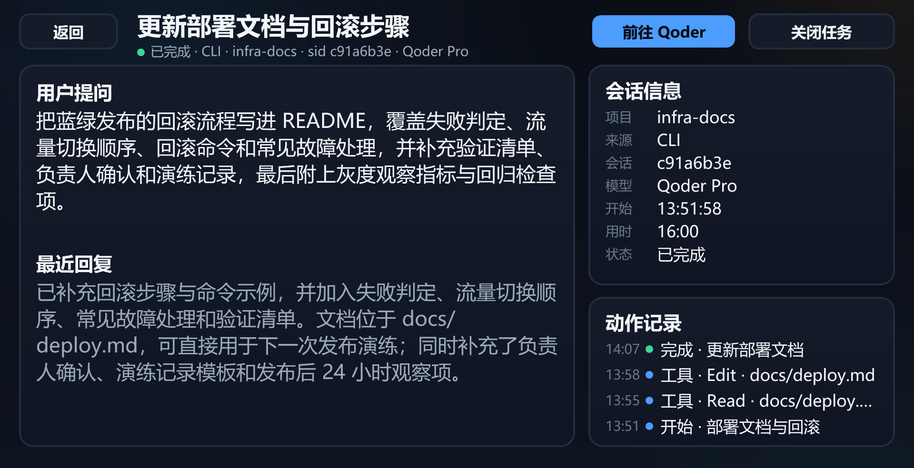

# Qoder HUD

在副屏、小屏或桌面角落显示 Qoder 任务的实时仪表盘。集中展示 Qoder Desktop、JetBrains 插件和 qodercli 会话的来源、标题、状态、当前工具和最近活动。

当前版本：**1.0.0** · Windows 10/11 · WPF/GPU 渲染 · MIT


> 界面预览使用内置演示数据，不包含本机任务。

## 特性

- 来源标记：Qoder Desktop、JetBrains、CLI、未知来源。
- 任务标题来自 Qoder 本地数据库或 JetBrains idea.log，失败时回退到用户输入。
- 单击打开详情，双击切换到 Qoder，右键菜单不会误关任务。
- 运行 / 等待 / 完成三态，显示模型、会话、当前工具、耗时和动作记录。
- 滚动列表带 200ms 缓出动画；托盘显示/隐藏、清空已完成、置顶开关。
- WPF 保留模式 + GPU 合成，静态画面不整帧重绘。
- 自适应工作区大小和缩放；可选显示器、位置和比例。
- 内置演示截图模式，可生成不含本机任务的主界面和任务详情预览。

## 系统要求

- Windows 10 / 11。
- .NET Framework 4.8（Windows 自带）。
- Qoder Desktop、Qoder JetBrains 插件或 qodercli，用于把事件写入 HUD。
- 无需 Node.js，无需管理员权限。

HUD 可以独立运行；没有 Qoder 或 hooks 时会显示空闲界面。

## 安装

1. 从 GitHub Releases 下载 `QoderHud-1.0.0.zip` 并解压。
2. 双击 `install.cmd`；需要开机自启时运行 `install.cmd -Autostart`。
3. 重启 Qoder 或新开一个会话，让新的 hooks 生效。

默认位置：

- 程序：`%LOCALAPPDATA%\QoderHud`
- 配置：`%APPDATA%\QoderHud\config.json`
- 日志：`%LOCALAPPDATA%\QoderHud\hud.log`

安装器会备份 `%USERPROFILE%\.qoder\settings.json`，只替换包含 `QoderHudHook.exe` 的条目，其他 hooks 保留。旧的 `%USERPROFILE%\.qoder\hud` 目录不会被自动删除。

详细参数、迁移和卸载见 [安装与卸载](docs/install.md)。

## 配置

配置文件在 `%APPDATA%\QoderHud\config.json`。托盘菜单可以“打开配置”和“重新加载配置”。

```json
{
  "display": "auto",
  "position": "auto",
  "scale": 1.0,
  "topmost": true,
  "qoderDataDir": "",
  "jetbrainsLogDir": ""
}
```

常用的四个字段：

| 字段 | 说明 |
| --- | --- |
| `display` | `auto` 优先最小的非主显示器；`primary` 主屏；也可填设备名后缀，如 `DISPLAY2`。 |
| `position` | `auto`、`center`、`top-left`、`top-right`、`bottom-left`、`bottom-right`。 |
| `scale` | 0.5–2.0，默认 1.0；工作区不足时自动缩小。 |
| `topmost` | 初始置顶状态；置顶按钮保存的状态优先。 |

`qoderDataDir` / `jetbrainsLogDir` 用于非标准数据目录。完整字段、示例和 DPI 说明见 [配置说明](docs/configuration.md)。

## 使用

- 单击任务：打开详情。
- 双击任务：切换到 Qoder。
- 右键任务：前往 Qoder / 关闭任务。
- 右键空白处：托盘主菜单。
- 右上角“置顶”：切换置顶并保存。
- 滚轮：滚动任务列表。
- 托盘：显示/隐藏、打开配置、重新加载配置、打开日志、清空已完成、退出。

HUD 不抢焦点。滚轮需要 Windows 的“滚动非活动窗口”功能开启；详见 [故障排查](docs/troubleshooting.md)。

单击任务后进入详情：



> 详情预览同样使用内置演示数据。

## 卸载

运行 `uninstall.cmd`。需要同时删除配置、置顶状态和日志时运行 `uninstall.cmd -RemoveData`。

## 故障排查

- HUD 一直空闲：重启 Qoder 让 hooks 生效，检查 `%LOCALAPPDATA%\QoderHud\hud.log`。
- 没有标题：检查 Qoder 数据目录 / JetBrains 日志，或用配置覆盖。
- 滚轮无效：开启 Windows“当我悬停在非活动窗口上时滚动它们”。

完整说明见 [故障排查](docs/troubleshooting.md)。

## 隐私

所有数据只在本机处理和保存，不联网。Hook 只采集白名单环境变量、工作目录、工具摘要和会话元数据。详见 [隐私说明](docs/privacy.md)。

## 开发与发布

```text
build.cmd      # 编译到 bin\
package.ps1    # 编译并生成 release\QoderHud-<版本>.zip
```

重新生成 README 预览图：

```text
bin\QoderHud.exe --screenshot docs\images\hud.png
bin\QoderHud.exe --screenshot-detail docs\images\hud-detail.png
```

截图模式使用内置演示任务，不读取配置、hooks、会话或标题数据库。源码结构、架构、测试步骤和 GitHub Release 流程见 [开发与发布](docs/development.md)。

## 文档

- [安装与卸载](docs/install.md)
- [配置说明](docs/configuration.md)
- [故障排查](docs/troubleshooting.md)
- [隐私说明](docs/privacy.md)
- [开发与发布](docs/development.md)
- [更新日志](CHANGELOG.md)

## 许可证

[MIT](LICENSE)
